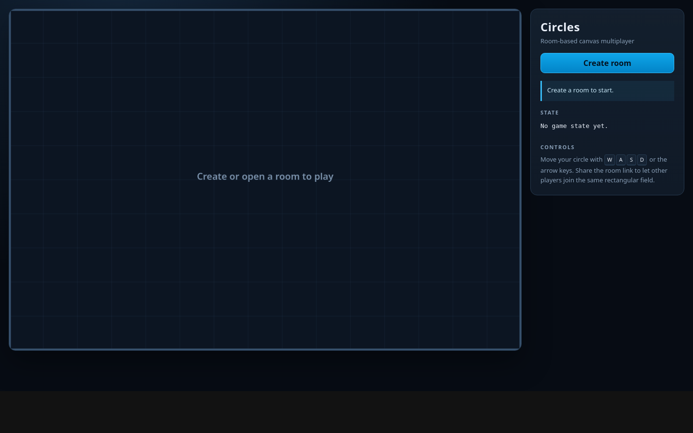
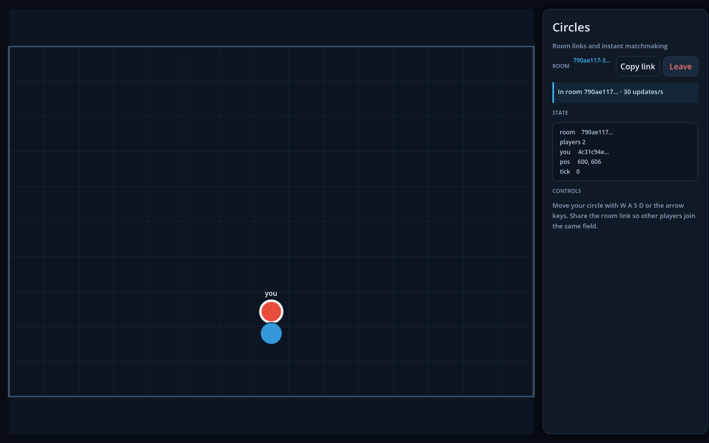

# Circles — realtime room game

A room-based multiplayer game in Go with a Godot 4.7 web client. Each room owns a
shared **1200 × 800** field. Players join by UUID, move with WASD or the arrow
keys, and render as colored circles. The server is authoritative and broadcasts
full state 30 times per second.

## What it does

- `POST /room` creates a room and returns its UUID; the Godot client auto-joins.
- A room link (`/?room=<uuid>`) admits up to `ROOM_CAPACITY` players.
- Movement is server-side: 260 world units/s, normalized diagonals, circles
  clamped inside the rectangle. Solid players keep moving: a player that contacts
  another slides out of overlap, and the other player is never moved.
- Every player gets a spawn slot around the field center and a palette color.
- Every 1/30 s the room actor serializes one full `UPDATE` snapshot and publishes
  it to every player; clients redraw from it rather than predicting state.
- Rooms expire after `ROOM_TIMEOUT`; clients receive a `1001 Going Away` close.
  An invalid, unknown, or already-closed room fails the upgrade with `1014`. A
  full room or duplicate player currently receives neither join data nor a
  close frame (recorded in the specs).

The game is intentionally a demo/template: there is no authentication,
persistence, reconnect, scoring, TLS, or multi-process state. The
behavioral contract is maintained as OpenSpec capability specs in
[`openspec/specs/`](openspec/specs/) — see
[AI-assisted development](#ai-assisted-development-with-openspec).

## Architecture

- One **room actor** (`core/room.Room.Run`) owns membership, the command queue,
  the ticker, the timeout, delivery, and close ordering. The game hook on top of
  it owns simulation, spawn slots, and all player positions.
- A **member** pairs an entity with an optional session. A player is the current
  entity kind and the only kind that contributes to UPDATE; an entity without a
  session is still simulated, indexed, and collided, but cannot be addressed.
- Each connection has exactly **one reader** (the HTTP handler) and **one
  writer** goroutine. There is no per-player inbound consumer.
- Movement keys are an atomic bitmask updated by the reader; the room tick reads
  the latest state. No key-event queue.
- Each tick moves every member in stable key order, refreshes the room quadtree
  once, and lets the room relocate exactly one body per contact (the only mover,
  or the later mover when both moved). The corrected positions are published
  immediately; the index catches up on the next tick's refresh. The spatial
  package never moves a body, and another player is never repositioned by a
  collision. The index also answers shape, radius, and nearest-point queries for
  actor-side gameplay; it is owned by the room actor, not shared across goroutines.
- Each **session** owns an outbound mailbox: a map from `SnapshotType`
  (`SystemType`, `PrivateType`, `BroadcastType`, `CustomType`) to the latest
  payload of that type. The session's writer sends one payload per type in
  numeric order.
- `SendTo` / `PublishTo` stage bytes directly into the target session's outbox —
  no actor command or pending map. `publishSnapshot` serializes one UPDATE per
  tick and stages it for every connected member as `BroadcastType`; each
  connection writer only consumes its own outbox.

## Screenshots

These images show the earlier Canvas client. The Godot client preserves the same
field, palette, panel, and responsive layout; re-capture them from a Godot build
when convenient.

**Lobby** — create a room, or open a shared `?room=` link:



**Gameplay** — three players in one room. Your circle has a light outline and a
`you` label; the side panel shows room/player state and the current tick:



## Requirements

| Tool | Version | Needed for |
| --- | --- | --- |
| [Go](https://go.dev/dl/) | `1.27.3` or newer | building, running, and testing the server; `go.mod` declares `go 1.27.3` |
| [Godot](https://godotengine.org/download) | `4.7` with the Web export templates | rebuilding and re-exporting the client; the project targets `4.7` in `client/project.godot` |
| [OpenSpec CLI](https://openspec.dev/) | `1.16.0` or newer | the spec workflow, validation, and archive (`openspec --version`) |
| Browser | WebGL 2 with WebSocket support | playing the Godot Web export |

Also required:

- A `.env` file in the working directory (checked in; all six values are required)
- The configured port free (sample: `8080`)
- An agent with the `/opsx:*` commands is optional and only needed for the
  assistant-driven spec workflow; the OpenSpec CLI alone can list, validate, and
  archive

This checkout is set up for Go `1.27.3`, Godot `4.7`, and OpenSpec CLI `1.16.0`.
Godot is only needed when rebuilding the client; the exported files under
`client/build/web` are enough to serve the game.

```bash
go version            # go1.27.3
godot --version       # 4.7 (Web export templates installed)
openspec --version    # 1.16.0
```

## Run

Build the Godot client first (once, and after any client change), then start the
server. The exported files land in the ignored `client/build/web` directory, which
`ASSETS_DIR` points at. Godot's CLI does not create the output folder, so create it
before the first export.

```bash
mkdir -p client/build/web
godot --headless --path client --import
godot --headless --path client --export-release "Web"
go run .
```

Without an export, the room and WebSocket endpoints still work, but `/` returns
404 because there is no `index.html` to serve.

Expected startup output:

```text
listening on http://[::]:8080
listening websocket on ws://[::]:8080/ws
```

Open <http://localhost:8080>, click **Create room**, and share the displayed room
link with other players. Opening the link joins the same room automatically.

### Controls

| Input | Action |
| --- | --- |
| `W` / `↑` | Move up |
| `S` / `↓` | Move down |
| `A` / `←` | Move left |
| `D` / `→` | Move right |

Your circle is outlined in white and labelled **you**. Releasing the window or
switching tabs releases all movement keys.

## Configuration

`.env` is loaded at startup. All values are mandatory and process environment
variables take precedence over file values.

| Variable | Sample | Meaning |
| --- | --- | --- |
| `PORT` | `:8080` | `net.Listen` address |
| `WS_ENDPOINT` | `/ws` | WebSocket upgrade path |
| `ROOM_ENDPOINT` | `/room` | Room-creation path |
| `ASSETS_DIR` | `./client/build/web` | Godot Web export root |
| `ROOM_TIMEOUT` | `30m` | Fixed room lifetime; positive duration |
| `ROOM_CAPACITY` | `8` | Maximum players/spawn slots; positive integer |

The client hard-codes `/room` and `/ws`, so changing the endpoint variables also
requires editing `client/scripts/protocol.gd`.

World and gameplay constants are compiled in:

| Constant | Value |
| --- | --- |
| World size | `1200 × 800` |
| Player radius | `25` |
| Tick rate | `30 Hz` |
| Movement speed | `260 units/s` |
| Outbound state | Latest snapshot per player (coalesced) |

## Wire protocol

Messages are JSON text frames with a numeric type and payload:
`{"type": <number>, "data": ...}`. On the server these numbers form the
`event.MessageType` enum (`internal/game/event/protocol.go`); the Godot client
mirrors them in `client/scripts/protocol.gd`.

| Direction | Type | Payload |
| --- | --- | --- |
| Client → server | `200` | `{key: <direction>, state: bool}` where direction is `UP`, `DOWN`, `LEFT`, or `RIGHT` |
| Server → client | `4` | Join success: `{playerId, roomId, width, height, radius, color, tickRate}` |
| Server → client | `100` | Update: `{players:[{id, position:{x,y}, radius, color}], width, height}` |
| Server → one client | `110` | Private event produced by `GameRoom.SendTo` |

`playerId` from JOIN_SUCCESS identifies the client's circle inside the `players`
array; the public UPDATE is identical for every recipient. Private `110` frames
are sent only to their target and are never included in the shared UPDATE.
Updates are full snapshots, not deltas. Unknown or malformed client messages are
logged and ignored. No client `JOIN` message is required: the room comes from the
WebSocket query string. `X-Player-Id` is optional for non-browser clients and
duplicates are rejected.

## Targeted messages

The shared UPDATE is public and must not carry per-player secrets. Use `SendTo`
to set the target’s private data slot:

```go
err := gr.SendTo(playerID, room.MsgPrivate, map[string]string{
    "message": "only this player receives this",
})
```

`SendTo` marshals the payload and stages it in the target’s `PrivateType`
outbox slot — no actor command. The connection writer drains slots in numeric
order (`SystemType`, `PrivateType`, `BroadcastType`, `CustomType`), so private
data is never embedded in UPDATE.

The outbox has one latest slot per type, so multiple `SendTo` calls coalesce
until the writer drains that slot: the last private payload wins. Broadcast data
is the same shared `UPDATE` for every player.

Extension types use `PublishTo`:

```go
err := gr.PublishTo(playerID, snapshot.CustomType, myMessageType, payload)
```

Add a `SnapshotType` constant before `TypeCount` in
[snapshot.go](internal/core/snapshot/snapshot.go) and use it through `PublishTo`;
the outbox and writer pick it up in numeric order.

`SendTo` returns `room.ErrPlayerNotFound` for missing/stopped players and
`room.ErrRoomClosed` while closing. A nil return means staged for the writer,
not delivered; a stop racing with `SendTo` drops the frame. It does not need to
run on the actor goroutine — actor code can publish through the member's session
directly.

Private frames use type `110` and are normal top-level events. The Godot client
does not handle `PRIVATE` yet; the message dispatch in
`client/scripts/network.gd` is the extension point.

Close codes: `1014` for an invalid room ID, unknown room, or already-closed room;
`1001` for room expiry or a server-initiated room close; `1009` for messages over
32 KiB. A join rejected by the room's own admission checks (full room or
duplicate player) currently receives neither join data nor a close frame — the
specs record this gap explicitly. Server shutdown may produce `1006` because the
server context is canceled before room close handshakes.

## Project layout

```text
main.go                         server bootstrap and shutdown
internal/config/config.go       .env loading and validation
internal/server/game_server.go  routes, room registry, admission, connection wiring
internal/core/entity/           entity contract, base identity/position, world size
internal/core/snapshot/         snapshot types and latest-per-type outbox
internal/core/session/          per-connection outbox, writer, close behavior
internal/core/room/             generic room: membership, commands, ticker, timeout, delivery
internal/game/room/             game policy: admission, spawns, simulation, contacts, UPDATE
internal/game/player/           player entity, controller, profile, movement
internal/game/event/            message numbers, payload shapes, JSON envelope
internal/spatial/               world-bounded quadtree + circle/AABB collision detection
internal/shared/                generic heap, concurrent set + reusable-timer scheduler
client/project.godot            Godot 4.7 project settings and Network autoload
client/export_presets.cfg       single-threaded Web export preset
client/scenes/main.tscn         lobby and side-panel scene
client/scenes/game_field.tscn   field rendering scene
client/scripts/main.gd          room flow, layout, input, status
client/scripts/network.gd       HTTP room creation and WebSocket transport
client/scripts/platform.gd      browser bridge and desktop fallback
client/scripts/game_field.gd    field and player drawing
client/scripts/protocol.gd      message numbers and endpoint paths
client/scripts/ui_theme.gd      palette and control styles
client/build/web/               generated Web export (ignored)
docs/                           README screenshots
openspec/config.yaml            OpenSpec workflow schema (spec-driven)
openspec/specs/                 capability specs (behavioral contract)
openspec/changes/               in-flight changes and archive
main_test.go                    integration and leak tests
```

## AI-assisted development with OpenSpec

The project uses [OpenSpec](https://openspec.dev/) (CLI `1.16.0`) for
spec-driven development. The behavioral contract is a set of validated
capabilities under [`openspec/specs/`](openspec/specs/), not a free-form document.
The current set passes `openspec validate --specs --strict`: twelve capabilities,
90 requirements, and 215 scenarios. The specs describe current behavior; known
gaps (full or duplicate joins receiving no close frame, and UPDATE carrying no
`tick`) are recorded as scenarios rather than quietly omitted.

| Capability | Covers | Requirements |
| --- | --- | --- |
| [`room-lifecycle`](openspec/specs/room-lifecycle/spec.md) | creation, registration, admission, spawn slots, join, rejected joins, disconnect, timeout, close, shutdown | 10 |
| [`room-gameplay`](openspec/specs/room-gameplay/spec.md) | world bounds, input state, movement, tick cadence, collision ordering, one-sided correction, determinism | 8 |
| [`room-messaging`](openspec/specs/room-messaging/spec.md) | outbox channels, coalescing, broadcast UPDATE, writer, private messages, error semantics, extension | 7 |
| [`entity-model`](openspec/specs/entity-model/spec.md) | heterogeneous membership, connection-less members, per-instance behavior, deterministic ticks, snapshot contribution, game-rule-free core | 7 |
| [`wire-protocol`](openspec/specs/wire-protocol/spec.md) | routing, asset delivery, room creation, envelope, message numbers, payload shapes, handshake limits, identity, close codes | 12 |
| [`server-configuration`](openspec/specs/server-configuration/spec.md) | `.env`, required variables, validation, endpoint wiring, compiled constants | 5 |
| [`spatial-index`](openspec/specs/spatial-index/spec.md) | world-bounded quadtree, insertion, bulk replacement, shape/radius/nearest queries, room integration | 8 |
| [`spatial-collision`](openspec/specs/spatial-collision/spec.md) | geometry, penetration, exact contact detection, ordering, read-only reporting | 6 |
| [`shared-scheduler`](openspec/specs/shared-scheduler/spec.md) | timer API, callbacks, shutdown, room timeout integration | 7 |
| [`shared-heap`](openspec/specs/shared-heap/spec.md) | generic heap contract used by the scheduler | 4 |
| [`shared-set`](openspec/specs/shared-set/spec.md) | concurrent keyed set used for room membership | 8 |
| [`godot-client`](openspec/specs/godot-client/spec.md) | project/export, browser bridge, lobby, session, rendering, input, statistics, layout | 8 |

### Workflow

Behavior changes are proposed as a change, implemented, and then archived;
archiving merges the delta specs into `openspec/specs/`.

| Step | Purpose | Agent command | CLI |
| --- | --- | --- | --- |
| Explore | think through a problem before proposing | `/opsx:explore` | `openspec list --specs` |
| Propose | create a change with proposal, specs, design, tasks | `/opsx:propose` | `openspec new change <name>` |
| Apply | implement the change and check off tasks | `/opsx:apply` | `openspec status --change <name>` |
| Update | revise a change's planning artifacts | `/opsx:update` | - |
| Sync | merge delta specs without archiving | `/opsx:sync` | - |
| Archive | merge specs and archive the change | `/opsx:archive` | `openspec archive <name>` |

The `/opsx:*` commands and matching skills are installed locally under
`.claude/` and `.dsh/` (both gitignored). The portable part of the workflow is
the `openspec/` tree plus the OpenSpec CLI.

Useful commands:

```bash
openspec list --specs                  # capabilities and requirement counts
openspec show room-lifecycle --type spec
openspec list                          # active changes
openspec validate --specs --strict     # validate the main specs
openspec validate <change> --strict    # validate a change's deltas
```

Rules of thumb:

- Do not edit `openspec/specs/` directly for a behavior change; add a change
  under `openspec/changes/` and let archive merge it.
- Keep scenarios observable and testable; they double as acceptance criteria.
- Validate strictly before review or archive.

## Test

```bash
go test ./...
go test -race ./...
```

The integration test starts the real server on port **8080**, creates a room,
connects two players, validates JOIN_SUCCESS and the UPDATE shape, sends a
`RIGHT` key event, and asserts that the player's `position.x` increases. A unit
test checks that a private event reaches the target's outbox as a separate frame
and not another player's. The suite takes about three to four seconds and is
not parallel-safe because it uses a fixed port. The Godot client is not exercised
by the Go suite; rebuild it with the export commands above and verify in a
browser. Specs are validated separately with `openspec validate --specs --strict`.

## Limitations

- Room timeout is fixed from creation; player activity does not extend it.
- Room closing waits for WebSocket close handshakes (5 s to write the close frame
  plus 5 s for the peer to answer, so up to ~10 s), and the room stays in the
  registry until that finishes; reconnects during that window are rejected as
  closed.
- Collisions are discrete tick detection, not continuous collision detection:
  fast objects can tunnel. Correction is one-sided and processed in stable player
  order, so a head-on pair is resolved in favor of the earlier mover, and dense
  clusters or wall corners may retain a small residual overlap in a single pass.
  Collision corrections are published immediately but reach the spatial index on
  the next tick's refresh. There is no two-sided push. There is no rounds, scoring,
  win conditions,
  spectators, or reconnect/session resumption.
- No obstacles, collectable items, shots, or area skills are spawned yet. The
  spatial engine supports them, but there is no wire format or rendering, and
  spatial queries must run on the room actor goroutine.
- Room UUID is the only access capability; there is no auth, rate limiting, TLS,
  health endpoint, metrics, or multi-instance support.
- The Go server never builds or checks the client: `/` returns 404 until the Web
  export exists under `client/build/web`. The Godot Web payload (`index.wasm`) is
  tens of megabytes, so first load is much heavier than the old Canvas client.
- Slow clients skip intermediate snapshots; each outbox keeps only the latest
  payload per type.
- `SendTo` calls coalesce to the last private payload until the writer drains the
  slot. Outbound data is latest-per-type, not a queue; add explicit buffering at
  the caller for lossless high-rate delivery.
